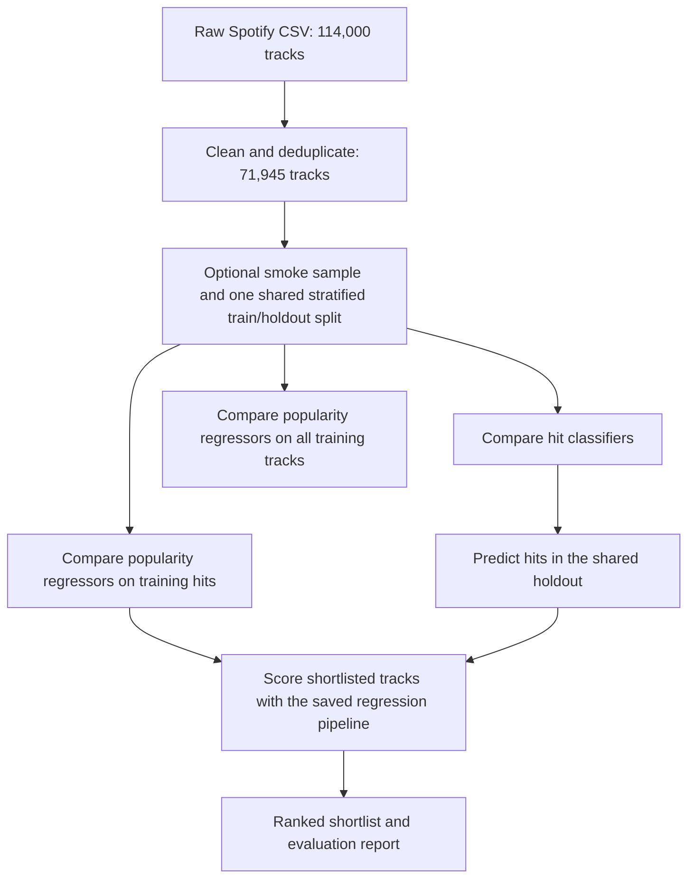

# Spotify popularity prediction

This Python/Jupyter project explores whether Spotify audio features can predict a track's popularity. It compares hit/non-hit classification, numerical popularity regression, and classification followed by regression. A hit is **Spotify popularity > 70**. The dataset has no actual Billboard labels, so the project does not validate Billboard Hot 100 prediction.

See [VALIDATION.md](VALIDATION.md) for the completed small-scale test, measured results, and the command for the prepared full-data run.

## Start here

The original five notebooks and datasets remain in the repository root. Corrected, automated copies are in `pipeline_notebooks/`. Backups made before changing existing documentation are in `backups/20261021_pipeline_setup/`, including file hashes and a change manifest. Historical notebook results remain available in the originals and backups.

Use the project virtual environment, not macOS's system Python:

```bash
cd /Users/anishech/Projects/ML_Spotify
.venv/bin/python run_pipeline.py --profile smoke
```

To check the installed environment and full search plan without training:

```bash
.venv/bin/python run_pipeline.py --profile full --check
```

To start the full-data experiment yourself:

```bash
.venv/bin/python run_pipeline.py --profile full
```

On macOS, keep the machine awake for a long run:

```bash
caffeinate -i .venv/bin/python -u run_pipeline.py --profile full
```

Each command prints its output directory. Training commands execute all five notebooks automatically, stop on failure, and retain completed outputs. An existing output directory is never overwritten. A check-only command also creates a small audit directory with `status: checked_only`, but does not execute notebooks or train models.

## Pipeline flow



Execution is sequential: data processing → classification → general regression → high-popularity regression → combined workflow. Each notebook contains explanations and calls helpers in `pipeline_lib.py`; model definitions and search spaces are in `pipeline_models.py`.

Every estimator is a complete pipeline: genre target encoder → StandardScaler → PCA retaining 95% variance → model. These transforms are fitted inside each CV fold. Training genre encodings are internally cross-fitted. Classifiers and regressors have separate encoders and PCA transforms, and saved Joblib files include them all.

## Profiles and runtime

| Profile | Data | CV folds | Candidate settings per family |
|---|---|---|---|
| `smoke` | 8,000 stratified cleaned tracks | 2 | 2; smaller tree ensembles |
| `full` | All 71,945 cleaned tracks | 5 | Up to 30 |
| `original_budget` | All cleaned tracks | 5 | 600 classification / 3,000 general regression / 1,500 hit regression |

All profiles exercise 10 classifiers and 8 regressors in each regression stage. Finite search spaces cap candidate counts. Full and original-budget profiles use larger tree ensembles and broader spaces than smoke. Search is reproducible with seed 42. Two search workers and one native thread per worker limit CPU contention; change workers with `--n-jobs 4`. Model selection is by positive-class F1 for classification and validation RMSE for regression. The same holdout is used across stages; the hit regressor filters the train and holdout partitions separately.

Full-data training can take hours, especially SVC and ensemble searches. The original-budget profile is substantially larger and may take days. It preserves the old per-family candidate budgets, not the old invalid validation or every old parameter combination. The combined stage reuses the selected classifier instead of repeating another 1,500-candidate classifier search. Full-data mode has no notebook-cell timeout. No full training is launched by `--check`.

To customize a run, copy a config under `configs/` and pass `--config path/to/config.json`.

## Outputs and logs

```text
runs/<India-time timestamp>_<profile>/
  pipeline.log                  # Live stage/model progress
  run_manifest.json             # Status, settings, timing, source/input hashes
  config.json                   # Effective configuration
  environment.json              # Python, package versions and import checks
  requirements.freeze.txt       # Exact packages for this run
  search_plan.json               # Candidate and fit counts per model
  RESULTS.md                    # Run-specific explanation of results
  source/                       # Snapshot of executed notebooks and helpers
  logs/                         # Per-stage progress and notebook output/error logs
  executed_notebooks/            # All cell outputs, including partial outputs on failure
  data/                         # Cleaned data, modeling sample, split and track identities
  models/                       # Complete fitted pipelines, winners and baselines
  cv_results/                   # Parameter-search scores
  metrics/                      # Per-model JSON, summaries and selection records
  predictions/                  # Holdout predictions and ranked_candidates.csv
  plots/                        # Distributions, confusion matrix and regression plots
```

Timestamps and the manifest use Asia/Kolkata. Watch progress with `tail -f runs/<your-run>/pipeline.log`. Completed cells are also saved into executed notebooks. If a stage fails, the command exits nonzero and records a traceback in `logs/failure.log`. Failed and interrupted runs keep their artifacts; restart with a new run directory. Automatic resumption is not implemented. Do not edit code or inputs during a run; completion verifies their hashes.

After a run, verify its artifacts:

```bash
.venv/bin/python verify_run.py runs/<your-run>
```

For discussing results, share the run directory or `RESULTS.md`, `run_manifest.json`, and the three `metrics/*_summary.csv` files. Include `metrics/combined.json` for the combined workflow or `logs/failure.log` if it fails.

## Setup on another machine

The tested environment uses Homebrew Python 3.14 on Apple Silicon. Exact resolved versions are in `requirements.lock.txt` and every run's freeze file. Python packages are installed in `.venv`; XGBoost also requires the macOS OpenMP runtime supplied by Homebrew.

```bash
brew install libomp
python3.14 -m venv .venv
.venv/bin/python -m pip install -r requirements.lock.txt
.venv/bin/python -m pip check
.venv/bin/python -m ipykernel install --prefix .venv --name ml-spotify --display-name "ML Spotify (.venv)"
```

`requirements.txt` lists direct dependencies, including libraries imported by the historical notebooks. The corrected pipeline uses scikit-learn's built-in cross-fitted target encoder. The runner creates a run-local kernel specification pointing at its own interpreter, so another globally installed Jupyter kernel cannot silently be used.

The corrected notebooks expect the run environment supplied by the runner. To read step by step, open a completed copy in `executed_notebooks/`. The original root notebooks are historical experiments and retain their original path, dependency and validation issues.

## Reading the results

The original processed dataset has only 2,281 hits among 71,945 tracks. A classifier that predicts every song as a non-hit achieves approximately 96.8% accuracy while finding no hits. We therefore report hit precision, hit recall, F1, average precision, balanced accuracy and a confusion matrix against a majority-class baseline.

Regression reports MAE, RMSE, R² and the percentage within ±5 popularity points, compared with a training-mean baseline. The ±5 percentage is not classification accuracy. MAPE is omitted because zero popularity makes percentage errors unsuitable. High-popularity regression has a narrower target range and must be interpreted separately.

The combined stage evaluates every shortlisted song, including false positives, and saves a ranked shortlist with track names and artists. Its regression metrics describe that shortlist, not every song. A regressor trained on known hits may overestimate false positives.

Original results cannot be compared directly with corrected results because the splits, samples, encoding, validation and model-selection criteria differ. Training metrics are descriptive: target encoding uses cross-fitting during fit and the final full-training encoding during prediction. Holdout measurements are the evidence for generalization within this dataset. Random track splitting does not establish performance on future songs or unseen artists. Smoke results verify the workflow and are not a final model comparison.

## Verification

```bash
.venv/bin/python -m unittest discover -s tests -v
.venv/bin/python verify_run.py runs/<completed-run>
```

Tests cover a disjoint shared holdout, duplicate split rejection, an empty shortlist, false positives retained in combined evaluation, single-row metric handling and invalid worker configuration. Model training additionally verifies that reloaded pipelines reproduce predictions from original features.

## Authors

Rohit Agrawal (24M0744), Daksh Goyal (24M0756), Gaurav Kumar (24M0786), Anishek Chaudhary (24M0787).
